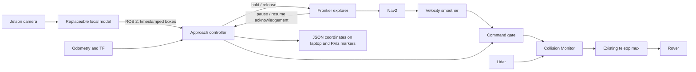

# Detect, measure, save coordinates, and resume exploration

The Jetson continuously runs the camera and `perception/landmark_detector`.
It publishes **every processed frame**, including frames with no detections,
on `/landmarks/detections`. These are small JSON messages with source image
timestamps, intrinsics, classes, confidence and normalized bounding boxes.
Images stay on the Jetson unless a debug viewer subscribes to them.

The navigation computer runs SLAM, Nav2, the frontier explorer and
`object_approach`. The first usable dispenser or cow-stall detection interrupts
exploration for a short measurement. As soon as a usable distance is obtained,
the laptop saves the object's map coordinates and resumes frontier exploration.
There are two targets: one `food_dispenser` and one `cow_enclosure` (cow stall).
Saved targets can be measured again after a cooldown and movement to another
viewpoint. Compatible measurements are fused to refine the saved coordinates.
Unmeasured targets have priority when both are visible. Exploration continues
after both have been recorded, until the frontier explorer finishes normally.

| Machine | Processes |
| --- | --- |
| Jetson, connected to the sensors | Lidar driver, camera driver and camera mounting TF, local model inference. |
| Separate Linux laptop | Scan timestamp correction, odometry TF republisher, SLAM, Nav2, frontier explorer, approach controller and command gate. |

The existing robot odometry reaches the laptop on `/Team2/odom`. The Jetson
publishes `/scan_raw` and `/landmarks/detections` across the network. The
laptop owns `/scan`, `odom -> base_link`, and `map -> odom`. The Jetson owns
the static camera mounting transform; the laptop receives it through
`/tf_static`. Do not start another SLAM or odometry TF publisher on the Jetson.



## What the geometry can establish

This approach makes sense with **measured forward displacement**. Changing
pixel size alone supplies a distance ratio, not metres. For a static rigid
feature, fixed focal length and straight motion along the viewing direction:

```text
s0 = k / Z0
s1 = k / (Z0 - d)
Z0 = d * s1 / (s1 - s0)
Z1 = d * s0 / (s1 - s0)
```

`s` is a linear image size (height here), `d` is actual forward displacement
from odometry, `Z0` the initial camera distance, and `Z1` the current distance.
For example, growth from 100 to 110 pixels over 0.10 m implies 1.10 m initially
and 1.00 m currently. These equations follow from the
[pinhole projection model](https://docs.opencv.org/4.x/d9/d0c/group__calib3d.html).
Do not apply the linear formula directly to box area.

The implementation fits `1 / size = intercept + slope * travel` over every
frame of the leg, once, when the leg ends. It requires at least five samples,
8 cm of baseline and 4% growth to fit at all, and keeps the answer only when
the fit's propagated sigma on the range is within `max_range_sigma_ratio` of
that range. How far the rover drives is set by `target_growth`, measured
geometry, not by fit quality: stopping at the first fit that looked clean
selected the shortest baseline and the luckiest noise, which is the least
precise estimate on offer reported with the most confidence. No object dimensions are required. Distance samples use
the odometry TF at **image capture time**, rather than the pose when inference
finishes. The current distance also accounts for travel since that image.
The existing TF republisher timestamps received Create3 odometry on the
navigation computer; its transport latency remains a source of range error.

Pointing at a box centre aligns the rover **toward** the object. It does not
estimate the object's surface normal or guarantee a perpendicular docking
pose. That requires keypoints, a fiducial, depth geometry or a pose model.
Use a stationary stall/dispenser or a rigid feature on it: a moving animal,
deforming object, box occlusion or changing head/body detection is not a
stable size reference. Slow systematic detector bias or odometry slip can
still bias an apparently good fit; the fit residual is not a calibrated
distance uncertainty.

## States and stop conditions

| State | Behaviour |
| --- | --- |
| `EXPLORING` | Pass fresh Nav2 commands through the gate while detector, odometry, scan and explorer heartbeats are present. |
| `STOPPING` | Gate outputs zero immediately. Repeated pause requests cancel all explorer goals, including goals still awaiting acceptance and return-home goals. Wait for terminal action results and measured stationarity. |
| `ALIGNING` | Rotate in place until the target is centred for three distinct frames and odometry reports that rotation has stopped. |
| `APPROACHING` | Take a bounded straight measurement; stop immediately when the range fit is usable. |
| `MEASURED` | Freeze the successful frame, publish zero, transform the target into the map and save it. |
| `RESUMING` | After stationarity, release the explorer's hold and wait for its acknowledgement before forwarding fresh Nav2 commands. |
| `STOPPED` | Stop an unsuccessful probe. Recoverable failures resume exploration when sensors are healthy and the rover is stationary; configuration, storage and handoff faults require intervention. |

The target stays matched by landmark, exact model class and box overlap.
Missing/ambiguous matches, clipped boxes, size/shape jumps, changed camera
calibration, stale detections, missing odometry/scan/acknowledgement, excessive
heading/lateral drift, and time/travel limits stop the approach. A late or
duplicate detection cannot refresh its watchdog or add a range sample.
The probe stops after 25 cm if there is no usable range estimate. The initial
probe has no metric camera range yet: lidar and the existing collision monitor
remain necessary throughout it, including when starting close to a target.

An obstacle between the rover and target is not a reason to keep approaching.
There is no final drive to a standoff anymore: the rover only moves enough to
measure. Collision Monitor still governs every measurement command. If the
rover makes no odometry progress for three seconds, the probe is marked
blocked and exploration resumes. No target coordinates are invented from
the obstacle's lidar range. An unsuccessful target becomes eligible again
after both a 20-second cooldown and at least 40 cm of movement to another
viewpoint. If there is never enough unobstructed motion to estimate range,
that target remains unsaved and is listed in `remaining_targets`.

Target loss, occlusion, unusable size growth, and probe limits follow the same
defer-and-retry path. Camera or sensor dropouts hold zero until live inputs
return. Resume requires a fresh explorer pause acknowledgement, healthy inputs,
and measured stationarity; a failed cancellation cannot release navigation.

The command gate runs **before** Collision Monitor, consistent with the
[Nav2 command-chain guidance](https://docs.nav2.org/rolling/tutorials/general_tutorials/using_collision_monitor/using_collision_monitor/).
It never publishes directly to `/Team2/cmd_vel`. The existing manual teleop
override remains available. Only this explorer should issue autonomous Nav2
goals in this workflow; leave camera coverage and the mission manager off.

## Build and run

Use the same ROS 2 Humble installation, domain and middleware on both machines:

```bash
source /opt/ros/humble/setup.bash
export ROS_DOMAIN_ID=2
export RMW_IMPLEMENTATION=rmw_fastrtps_cpp
export ROS_LOCALHOST_ONLY=0
```

Synchronize the Jetson and navigation host clocks (for example using chrony).
Source image stamps must be in this shared ROS clock domain; zero/future/old
stamps are rejected. DDS discovery and these topics must reach both machines.

Build on the navigation computer, from the repository root:

```bash
cd ros2_ws
rosdep install --from-paths src --ignore-src -r -y
colcon build --packages-up-to imdl_autonomy --symlink-install
source install/setup.bash
```

Nothing needs building on the Jetson. It has no colcon workspace for this
repo, so `jetson_bringup.launch.py` is launched by path and resolves its
siblings relative to itself; a `git pull` there is the whole deployment.

**Jetson, one terminal.** Lidar, camera, camera mounting TF and the detector:

```bash
ros2 launch ~/imdl-main/ros2_ws/src/perception/launch/jetson_bringup.launch.py \
  backend:=ultralytics \
  model:=~/imdl-main/ros2_ws/src/perception/models/cows_pipes_yolov8.pt \
  x:=0.08 y:=0.0 z:=0.35 roll:=-1.5707963
```

Measure the camera mounting and pass `x`, `y`, `z`, `roll`, `pitch`, `yaw` --
the defaults above are the values measured on 2026-10-25, relative to the
**lidar**, because `lidar.launch.py` stamps scans `base_link` and SLAM
therefore treats the lidar centre as `base_link`'s origin. With the optical
frame convention these files use, `roll = -pi/2` is a **level** camera;
`pitch` spins the image about the view axis rather than tilting it, so
downward tilt is `roll = -(1.5707963 + tilt)`.

The controller requires the optical axis within 0.05 rad of rover forward and
the lateral offset within 3 cm of the centreline, and refuses to measure
otherwise rather than fitting the wrong projection to forward odometry. Set a
fixed zoom/focus and use calibrated intrinsics for accurate results; the FOV
fallback is fine for bring-up. There must be only one publisher of
`base_link -> webcam_optical_frame`.

Omit `backend`/`model` **before the model arrives** and the default `disabled`
backend publishes empty frames: the live camera heartbeat with no weights,
which lets exploration run. Fixed `stub` boxes remain available for mapping
diagnostics but are explicitly excluded as approach targets -- they cannot
produce real size growth, so they never move the rover.

**The autonomy half, one terminal.** Scan restamp, odometry TF, SLAM, Nav2,
twist_mux, the frontier explorer, the approach controller and RViz:

```bash
ros2 launch imdl_autonomy autonomy_bringup.launch.py map_id:=my_map
```

Where that runs is a choice, and it is the main lever on how fast the whole
thing feels:

| | SPLIT | ONBOARD |
| --- | --- | --- |
| Runs on | the laptop's container | the Jetson's container, beside the sensors |
| Over the WiFi | lidar scans, detection JSON, cmd_vel, Create3 topics | RViz only |
| Between detector and autonomy | arena WiFi | FastDDS shared memory (`--net=host --ipc=host`) |
| Needs | nothing extra | a built workspace in the Jetson's container |
| RViz | in the same launch | `rviz:=false` here, `real_rviz.launch.py` on the laptop |

ONBOARD is `./scripts/imdl_tmux.sh --onboard --jetson … --laptop …`, and it
only pays off because the detector stays **native** on the Jetson: the
container image has no CUDA, so a detector inside it would run on the CPU.
Native for the GPU, container for the ROS packages, shared memory between.

Do not install the autonomy dependencies onto the Jetson's host system. Its
PyTorch is a hand-placed NVIDIA wheel, and `rosdep install -r -y` or a stray
`pip install` can swap it for a CPU wheel -- after which inference still works
and silently stops using the GPU.

All of that is one launch file because it has to be one machine: splitting the
TF chain across the WiFi made slam_toolbox drop every scan with `queue is
full` while Nav2 missed transforms by 0.6-2.2 s. Confirm
`ros2 topic hz /Team2/odom` is steady first -- Nav2's local costmap activation
fails *permanently* if odometry is late, and none flows while the Create3 is
docked or asleep.

Useful arguments:

| Argument | Effect |
| --- | --- |
| `rviz:=false` | Run RViz separately, for example when X is awkward over SSH. |
| `require_detector:=false` | Let Nav2 drive goals with no detector running. Nothing can be measured in that mode; see below. |
| `positions_file:=<path>` | Write coordinates to a chosen new file instead of a per-run one. |

Teleop stays a terminal of its own, since it has to read the keyboard. It sits
downstream of the Collision Monitor and outranks Nav2, so it drives even when
the command gate is holding the rover still:

```bash
ros2 run teleop_twist_keyboard teleop_twist_keyboard \
  --ros-args -r cmd_vel:=/Team2/cmd_vel_teleop
```

### The command gate stops the rover when detections go stale

By default the gate passes Nav2's velocity through only while detection frames
keep arriving -- within `detection_timeout` (0.8 s). With no frames there is
nothing to notice a target with, so driving on is driving blind, and a stalled
camera, model or WiFi link stops the rover rather than letting it explore
unable to see.

The cost is that the autonomous path then depends on the Jetson: no detector
running means no motion at all, including a manual RViz goal, and inference
slower than about 1.25 Hz has the same effect. `require_detector:=false`
decouples them for bringing up SLAM, Nav2 and goals on their own. Watch
`detector_fresh` and `detector_required` in `/approach/status`.

The tmux launcher pre-fills exactly this arrangement: window 2 is the Jetson
launch, window 4 the laptop launch, and the rest are read-only monitors.
The `landmark` window shows `/approach/object_positions`. The explorer accepts
ordered hold/release messages on `/frontier_explorer/hold` and acknowledges on
`/frontier_explorer/paused`. Its old `/frontier_explorer/pause` input is retained
for manual pauses. Restart both controller and explorer for a new run or to
recover from a critical fault; restarting only the controller cannot silently
release an existing hold.

## Saved positions for later use

Each successful measurement is saved **on the Linux laptop** to a per-run file:

```text
~/maps/detected_objects/<timestamp-and-session-id>.json
```

The exact path appears in the startup log and `/approach/status.positions_file`.
The file is created after the first successful measurement and contains both
objects after both are measured. Writes atomically replace the previous JSON
so an interrupted write does not leave a half-written document. Failure to
write stops the workflow instead of reporting an object as recorded.

Choose a specific new filename and label the matching map with launch arguments:

```bash
ros2 launch imdl_autonomy object_approach.launch.py namespace:=/Team2 \
  map_id:=arena_trial_1 positions_file:=/home/you/maps/arena_trial_1_objects.json
```

An existing filename is refused to avoid overwriting coordinates from a prior
map. New runs do not silently load old positions: a new SLAM map can have a
different origin. The tmux launch sets `map_id` to its map name automatically.

The following excerpt illustrates the fields to read (example coordinates):

```json
{
  "schema_version": 3,
  "map_id": "arena_trial_1",
  "frame_id": "map",
  "units": "metres",
  "objects": {
    "food_dispenser": {"position_map_m": {"x": 2.4, "y": 1.1, "z": 0.5}},
    "cow_enclosure": {"position_map_m": {"x": -0.8, "y": 3.2, "z": 0.4}}
  }
}
```

Use `objects[name].position_map_m.x/y` for later navigation in the **same map**.
The point is the estimated centre of the detected feature, not a collision-free
navigation goal or a docking pose. The `retained_measurements` list also contains
each view's model class, confidence, source image timestamp, optical depth,
sample count, baseline and fit residual. Detection alone does not add a position;
a usable range is required.

Projection uses the camera intrinsics, camera mounting offset and odometry TF
at the successful image's timestamp. The result is anchored in `odom` and
transformed into `map`. While running, a one-second update follows global
`map -> odom` corrections and rewrites coordinates if they move at least 1 cm.
This cannot undo historical wheel slip or local pose-graph deformation; the
positions are estimates, not surveyed landmarks. Save the corresponding SLAM
map after exploration, alongside the JSON file, and localize in that map when
using the positions later.

The same JSON is published on `/approach/object_positions`. RViz's
**Measured Objects** display shows labels and markers from
`/approach/object_markers`; these markers do not alter the occupancy grid.

## Remeasuring and refining an existing object

After saving a target, exploration resumes as before. That target can trigger
another measurement once **30 seconds** have passed and the rover is at least
**0.50 m from the previous successful measurement viewpoint**. Rotating in
place alone does not qualify. These limits avoid repeatedly stopping in front
of the same object. They also apply when a measurement was stored but rejected
by fusion. Failed probes still use the separate retry cooldown/viewpoint rules.

The new measurement is combined with the history using the existing landmark
bearing/range solver. Each view contributes a camera origin, viewing direction,
distance and estimated measurement error. Smaller assumed errors carry more
weight. Range noise is floored and grows with distance and poor expansion-fit
quality; bearing noise is also floored. These values are heuristics that must
be tuned against recorded trials, not a calibrated accuracy guarantee.

Directions matter: views from different sides constrain different directions
of position error. A different angle can therefore help more than repeatedly
viewing from the same line. The system does not command dedicated observation
poses; it remeasures opportunistically during frontier exploration. Improvement
is not guaranteed: camera calibration errors, wheel slip, moving objects, or
the detector choosing different parts of a stall can bias every measurement.
The reported uncertainty has an 8 cm standard-deviation floor to avoid claiming
arbitrary precision from many observations.

Before fusion, measurements are grouped by consistency of their estimated
positions and error models. The largest compatible group is used; ties favour
the previously used group. A new outlier is retained for comparison without
overwriting an established estimate. If the first measurement was wrong, two
later agreeing measurements can form a larger group and replace it. This
reduces sensitivity to a single bad estimate but cannot resolve several
consistent false detections. Continue using one stationary target of each
canonical class.

History is bounded to the three most recent measurements per 15-degree
sight-line bucket (at most 36 per object). This preserves other viewing angles
when one side is revisited repeatedly. The same source image is not counted
twice while retained. No raw camera images are saved.

In JSON schema version 2, `position_map_m` remains the coordinate to use and
now represents the **fused** estimate. Additional fields include:

| Field | Meaning |
| --- | --- |
| `measurement_count` | Total measurement records collected this run for this object. |
| `retained_measurement_count` | Number still in the bounded history. |
| `used_measurement_count` | Retained views used in the current position estimate. |
| `rejected_measurement_count` | Retained views outside the selected consistent group; they may become usable later. |
| `last_measurement_used` | Whether the latest record contributed to the estimate. |
| `fusion_status` | `single_view`, `fused`, or `disagreement`. |
| `sigma_major_m` | Largest estimated horizontal standard deviation, including the floor. |
| `covariance_xy_map_m2` | Row-major 2×2 estimated horizontal covariance in the map frame. |
| `view_angle_spread_deg` | Angular spread of the sight lines used by fusion. |
| `retained_measurements` | Per-view odometry position, camera origin, model/fit details, timestamp and `used` flag. |

The status topic includes `object_measurements`, and RViz labels show the used
view count and estimated uncertainty. Map corrections update the fused point
and rotate its covariance; the original odometry observations remain available
in the file for inspection.

## Add the trained model later

Replace the detector's `disabled` command with:

```bash
PYTHONPATH=ros2_ws/src/perception python3 \
  ros2_ws/src/perception/perception/landmark_detector_node.py --ros-args \
  -p backend:=ultralytics -p model_path:=/home/jetson/models/landmarks.pt \
  -p landmark_config:=ros2_ws/src/perception/config/landmarks.yaml \
  -p max_inference_rate_hz:=10.0
```

The existing backend accepts Ultralytics detection/segmentation `.pt` weights
and compatible TensorRT `.engine` files. Its runtime must be installed for
your JetPack version. The ONNX backend accepts the existing Ultralytics export
layout, with a label sidecar or `class_names_path`. Arbitrary ONNX layouts
require a custom backend.

Map your model's exact labels in `perception/config/landmarks.yaml`. The
shipped aliases cover `food_dispenser`/`dispenser`/`feeder` and
`cow_stall`/`cow_enclosure`/`stall`, retaining `cow_head`/`cow_body` for the
existing cutout model. A head/body transition stops the approach; it never
mixes their sizes. Other model architectures implement the existing
`DetectorBackend.load()` and `detect(image_bgr)` interface and register a
factory in `landmark_backends.py`. Return:

```python
RawDetection(
    model_class='food_dispenser', confidence=0.92,
    box_xyxy_px=(x_min, y_min, x_max, y_max),
)
```

Boxes must use the original input image's pixel coordinates, with any
letterbox padding undone. No autonomy code changes are required.

## Tune and verify

Runtime parameters live in `imdl_autonomy/config/object_approach.yaml`. To
use another file, pass `approach_params_file:=/absolute/path/config.yaml`.
Defaults are 0.06 m/s forward, 0.25 rad/s maximum turn, at most 0.25 m or
12 seconds per measurement, and a three-second no-progress timeout. The probe
ends sooner as soon as a usable range is obtained. Detector confidence is
filtered again at 0.65 by the controller. `retry_cooldown` and
`retry_viewpoint_m` control when an unsuccessful target may interrupt again.
`remeasure_cooldown` and `remeasure_viewpoint_m` control revisits to saved targets.
The `fusion_*` parameters configure the assumed measurement errors and outlier
threshold; they do not change the camera model or replace calibration.

```bash
ros2 topic echo /landmarks/detections
ros2 topic echo /frontier_explorer/paused
ros2 topic echo /approach/status
ros2 topic echo /approach/cmd_vel
ros2 topic echo /approach/object_positions
```

`range_m` is camera optical depth at the successful frame and is only usable
when `range_valid` is true. Use the saved map coordinates after exploration
resumes. `saved_objects`, `remaining_targets`, and `positions_file` report
progress. Nothing in this workflow starts dispensing or manipulation.

Hardware-free tests, from the repository root with numpy, pytest and PyYAML:

```bash
PYTHONPATH=ros2_ws/src/imdl_autonomy:ros2_ws/src/perception \
  python3 -m pytest -q \
  ros2_ws/src/imdl_autonomy/test/test_object_approach.py \
  ros2_ws/src/imdl_autonomy/test/test_frontier_pause.py \
  ros2_ws/src/imdl_autonomy/test/test_object_positions.py \
  ros2_ws/src/perception/test/test_landmark_detection.py
```

These cover short probes, distance recovery, interrupted measurements, target
revisits/retry, pause/resume races, multi-view correction, outliers, duplicate
images, bounded history, map projection and atomic persistence.
They have not been run for the measure/resume/fusion changes. They do not certify
actual ROS discovery, launch wiring,
camera calibration, odometry quality, braking distance or Jetson inference
latency; those still need a slow hardware trial with a stationary target.
